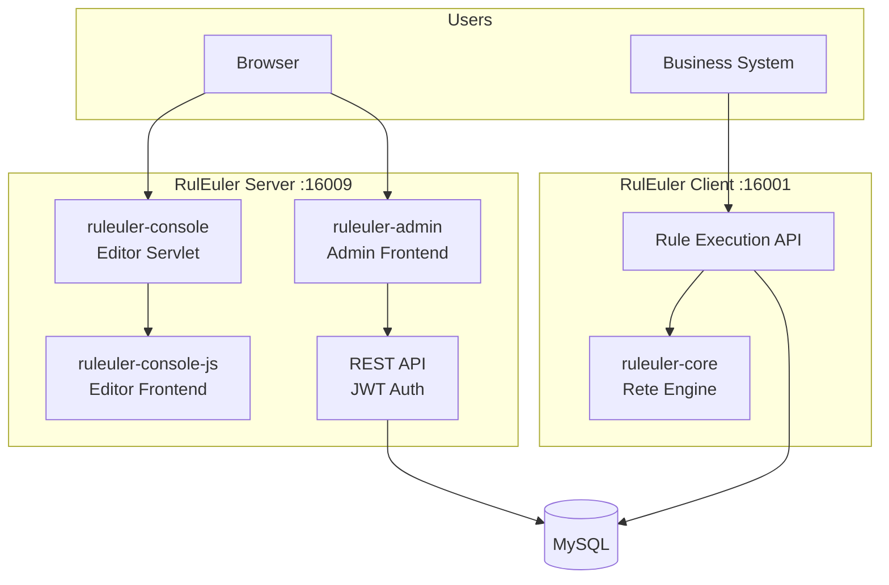

# System Architecture

## Module Structure

```
├── ruleuler-core              # Core engine (Rete algorithm, model definitions)
├── ruleuler-console           # Admin console Servlet (editor rendering, file operations)
├── ruleuler-console-js        # Legacy editor frontend (webpack + React, outputs *.bundle.js)
├── ruleuler-admin             # Modern admin frontend (Vite + React + Ant Design)
├── ruleuler-server            # Server (Spring Boot, JWT auth, REST API)
├── ruleuler-client            # Client (Spring Boot, rule execution, external API)
├── ruleuler-function-sdk      # Custom function annotations & compile-time APT
```

## Architecture Diagram



## Module Responsibilities

### ruleuler-core

Core rule engine implementing the Rete algorithm and rule model definitions. Kept stable without arbitrary modifications.

### ruleuler-server

Spring Boot application providing:

- JWT authentication
- Project and file management REST APIs
- RBAC permission control
- Static asset hosting for `ruleuler-admin` and `ruleuler-console`

### ruleuler-client

Spring Boot application providing:

- Decision flow execution API (`/process/...`)
- Knowledge package loading and caching
- Variable inspection API
- Built-in MCP Server (`/mcp`)

### ruleuler-admin

Modern admin frontend built with Vite + React + TypeScript + Ant Design.

Includes the REA expression editor, project management, automated testing, variable monitoring, release approvals, traffic replay, and dependency analysis.

### ruleuler-console / ruleuler-console-js

Legacy visual editors built on Servlet + webpack + React, providing visual editors for decision tables, decision trees, and decision flows.

## Tech Stack

| Layer | Technology |
|-------|------------|
| Backend | Java 21, Spring Boot 4.x, Maven |
| Frontend (Modern) | React, TypeScript, Vite, Ant Design |
| Frontend (Legacy) | React, webpack, bundle.js |
| Relational DB | MySQL 8.0+ |
| Time-Series DB | ClickHouse (rule execution monitoring) |
| AI Integration | Spring AI MCP Server (Streamable HTTP) |
| Rule Engine | Rete Algorithm |
| Authentication | JWT + RBAC |
| Deployment | Docker Compose |

