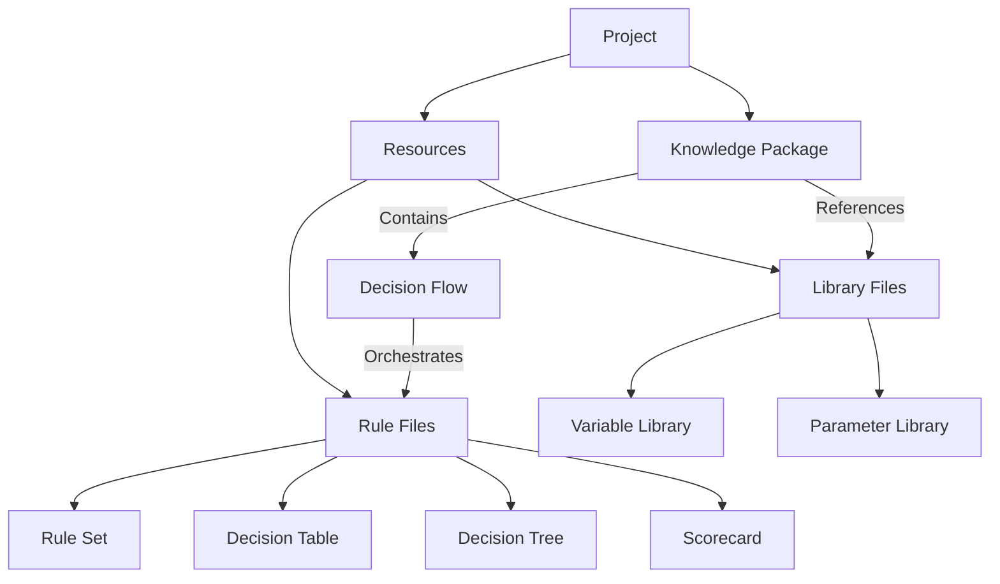
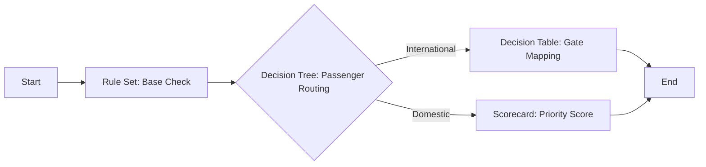
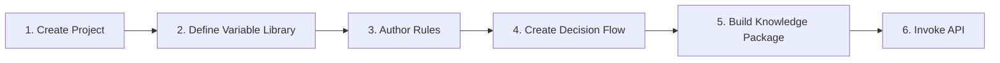

# Core Concepts

## Concept Relationships



In short: a project contains two main sections — **Resources** and **Knowledge Packages**. Resources hold library files and rule files. A knowledge package references library files and contains decision flows, while decision flows orchestrate rule files.

## Project

A project is the top-level container; all rule resources belong to a project. Each project has two fixed sections:

- **Knowledge Packages** — Packaging and release units for rules
- **Resources** — Storage location for library files and rule files

```
airport_gate_allocation_db/       # Project
├── Knowledge Packages/
│   └── gate_pkg                  # Release unit
└── Resources/
    ├── Libraries/                # Library files
    │   ├── flight_info.vl.xml    # Variable library
    │   ├── gate_result.vl.xml
    │   └── canshu0.pl.xml        # Parameter library
    ├── Rule Sets/                # Rule files
    │   └── intl_gate_rules.rs.xml
    ├── Decision Tables/
    │   └── aircraft_gate_map.dt.xml
    ├── Decision Trees/
    │   └── pax_gate_routing.dtree.xml
    ├── Scorecards/
    │   └── flight_priority_score.sc
    └── Decision Flows/
        └── gate_allocation_flow.rl.xml
```

Select a storage mode (`db` or `jcr`) when creating a project; it cannot be changed afterward. `db` mode is recommended.

## Resources: Library Files

Library files define the data structures used in rules — they serve as the "vocabulary" of your rules.

### Variable Library (`.vl.xml`)

The core library file type. It defines input and output variables grouped by category.

Each variable category corresponds to a top-level key in the API request body:

```json
{
  "FlightInfo": {          ← Variable category
    "aircraft_type": "A380",  ← Variable
    "arrival_time": 8
  },
  "GateResult": {}         ← Output category, populated after rule execution
}
```

See [GeneralEntity Variables](general-entity.md) for details.

### Parameter Library (`.pl.xml`)

Defines intermediate variables that do not belong to any category. Used to pass temporary values between rules, such as `can_score` or `can_reason`.

Parameters appear at the top level of the API response (outside any category).

### Constant Library (`.cl.xml`) and Action Library (`.al.xml`)

Constant libraries define fixed values; action libraries define callable Java methods (see [Custom Functions](rea-function-extension.md)).

## Resources: Rule Files

Rule files define specific business logic. Each type fits a different scenario:

| Type | Extension | Summary | When to Use |
|------|-----------|---------|-------------|
| Rule Set | `.rs.xml` | A group of `if-then-else` rules | Simple conditional checks with a moderate number of rules |
| Decision Table | `.dt.xml` | Matrix of conditions × actions | Many condition combinations requiring side-by-side comparison |
| Decision Tree | `.dtree.xml` | Tree-structured branches | Hierarchical conditions evaluated step by step |
| Scorecard | `.sc` | Weighted scoring & aggregation | Credit scoring, risk assessment |
| Decision Flow | `.rl.xml` | Orchestrates multiple rule nodes | Complex multi-step workflows |

Rule files support sub-folder organization (e.g., `intl_rules/asia/`).

Rule sets support two editing modes: the visual wizard and the [REA Expression Editor](rea-expression.md).

## Knowledge Package

A knowledge package bridges "editing" and "execution" and serves as the entry point for external invocations.

A knowledge package references library files and decision flows, compiling and bundling them into an executable unit. Decision flows are part of a knowledge package rather than standalone endpoints.

```
Knowledge Package: gate_pkg
├── References Variable Libraries: flight_info.vl.xml, gate_result.vl.xml
├── References Parameter Library: canshu0.pl.xml
└── Contains Decision Flow: gate_allocation_flow.rl.xml    ← External API entry point
    ├── Node 1: Rule Set intl_gate_rules.rs.xml
    ├── Node 2: Decision Table aircraft_gate_map.dt.xml
    ├── Node 3: Decision Tree pax_gate_routing.dtree.xml
    └── Node 4: Scorecard flight_priority_score.sc
```

A single knowledge package can contain multiple decision flows, each acting as an independent execution entry point.

Knowledge packages support hot-reloading — once published, clients load the updated package without restarting.

## Decision Flow

A decision flow defines the execution pipeline within a knowledge package, orchestrating rule nodes via a visual flowchart:



Each node in a decision flow references a rule file (rule set, decision table, decision tree, or scorecard) and executes sequentially along the connected edges.

Invocation endpoint:

```
POST /process/{project}/{packageId}/{flowId}
```

Where `packageId` specifies the knowledge package and `flowId` specifies the decision flow within that package.

## End-to-End Workflow



Taking airport gate allocation as an example:

1. Create project `airport_gate_allocation_db`
2. Define variable libraries: `FlightInfo` (input), `GateResult` (output), and parameter library (intermediate variables)
3. Author rules: decision table mapping aircraft type → gate, decision tree routing by passenger count, scorecard calculating priority
4. Create decision flow `gate_allocation_flow` chaining those rules
5. Create knowledge package `gate_pkg` referencing all libraries and the decision flow
6. Invoke via HTTP:

```bash
curl -X POST http://localhost:16001/process/airport_gate_allocation_db/gate_pkg/gate_allocation_flow \
  -H 'Content-Type: application/json' \
  -d '{"FlightInfo": {"aircraft_type": "A380", "arrival_time": 8, "is_international": true, "passenger_count": 260}, "GateResult": {}}'
```

## Rete Algorithm

RulEuler uses the Rete algorithm for rule matching. Rete constructs a discrimination network to avoid redundant condition evaluations, delivering higher throughput than sequential rule evaluation when matching large rule sets.

