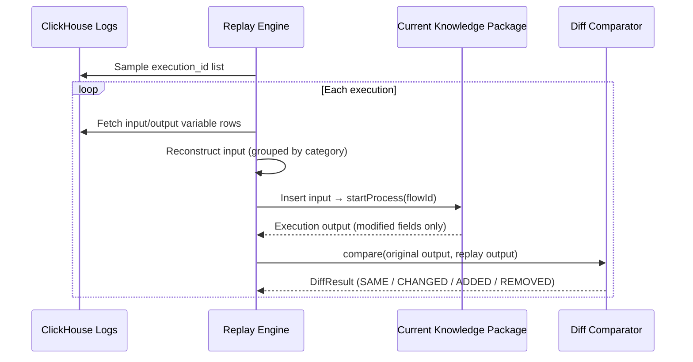

# Traffic Replay

Traffic Replay validates the real-world impact of rule changes by sampling historical requests from ClickHouse, re-executing them against the current knowledge package version, and comparing the outputs field by field against the original execution results.

## How It Works

Core pipeline:

1. Sample historical `execution_id` records from ClickHouse `execution_var_log`
2. Fetch all variable rows per `execution_id` to reconstruct the input payload and original output
3. Execute the replay locally against the current knowledge package via `KnowledgeSession`
4. Retain only fields modified relative to the input (aligned with online logging behavior)
5. Compare original vs. replayed outputs field by field to generate a diff report

## Sampling Strategies

| Strategy | Description |
|----------|-------------|
| `random` | Random sampling for quick validation |
| `uniform` | Evenly spaced sampling across the selected time window |
| `all` | Full replay of all matching executions in the time window |

## Missing Variable Handling

Historical logs may lack newly added variables. Three handling strategies are supported:

| Strategy | Description |
|----------|-------------|
| `segment` | Fill with the variable's default or zero value and mark as `INCOMPLETE` |
| `null` | Leave missing variables as `null` |
| `skip` | Skip incomplete execution records |

## Field-Level Diffs

Each output field is classified as:

| Status | Meaning |
|--------|---------|
| `SAME` | Original and replayed values match |
| `CHANGED` | Value changed between original and replay |
| `ADDED` | Replay produced a field not present in the original output |
| `REMOVED` | Original output had a field that was not produced during replay |

Numeric tolerance (exact match, absolute tolerance, or relative tolerance) is supported to avoid false positives from floating-point precision.

## Usage

1. Navigate to **Project Details → Traffic Replay** (or **Release Management → Traffic Replay**)
2. Select the knowledge package, time range, and sampling strategy
3. Click **Create** to start the replay task
4. Inspect the replay report: match rate, per-variable change statistics, latency comparison (average and P95), and per-request field diffs
5. **Export to Test Cases**: Export all, mismatched-only, or matched-only replay records into an automated test case pack for future regression runs

## Prerequisites

- ClickHouse is configured and contains historical execution logs (Variable Monitoring enabled)
- The target knowledge package is published and loadable

